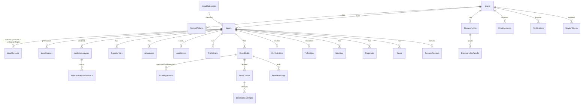

# Architecture, Database & API

## Modular monolith (clean architecture)

```
backend/
  src/LeadPilot.Domain          entities, enums (no dependencies)
  src/LeadPilot.Application     use-case services, provider interfaces, pure engines
      Abstractions/Providers.cs   ILeadDiscoveryProvider, IBusinessEnrichmentProvider, IWebsiteAnalyzer, IPageSpeedClient,
                                  IAIProvider, IEmailProvider, IWhatsAppProvider, INotificationProvider, IConsentService
      Common/                     IAppDbContext, IAuditService, IJobScheduler, options, errors, normaliser
      Intelligence/               LeadScoringEngine (ILeadScoringService), DuplicateDetector, OpportunityDetector,
                                  PromptLibrary (versioned prompts), AI JSON schemas + validator
      Leads/ Discovery/ Analysis/ Pitches/ Outreach/ Crm/ Compliance/ Notifications/ Reports/ Settings/ Auth/
  src/LeadPilot.Infrastructure  EF Core (PostgreSQL), migrations, Hangfire, security, providers:
      Providers/  GooglePlacesProvider, MockDiscoveryProvider (dev only), ClaudeAIProvider (official SDK), MockAIProvider (dev only),
                  FcmNotificationProvider, WhatsAppCloudProvider, PageSpeedClient
      Web/        UrlSafetyValidator + SSRF-safe handler, SafeHttpFetcher, WebsiteAnalyzer, RobotsRules
      Gmail/      GoogleOAuthService (PKCE), GmailEmailProvider, TestModeEmailProvider, MimeBuilder
      Jobs/       MaintenanceJob, BudgetMonitorJob, recurring job registration
  src/LeadPilot.API             controllers (REST /api/v1), JWT, rate limiting, Swagger, problem details
  src/LeadPilot.Worker          Hangfire server host (all background work)
  tests/LeadPilot.Tests         unit + integration tests
mobile/src/app/
  core/       api (cache + offline queue), auth (secure refresh token), config (HTTPS base URL), platform (push, deep links, theme)
  layout/     shell with bottom navigation
  features/   auth, dashboard, discover, leads, pitch, approvals, crm, followups, notifications, reports, settings
```

Key decisions:
- **AI never sets scores.** Claude returns schema-validated evidence/recommendations; `LeadScoringEngine` computes the score deterministically from configurable weights (normalised to 100) and stores a per-criterion breakdown.
- **Evidence first.** Every opportunity carries *evidence* (observed) and *assumptions* (caveats) separately; prompts forbid fabrication and the validator rejects opportunities without evidence and services you don't offer.
- **Providers are pluggable** behind interfaces; mocks exist only outside Production (`Providers:UseMocksWhenUnconfigured` is forced off in Production).
- **Durable jobs**: Hangfire with PostgreSQL storage; discovery jobs persist a resume cursor after every page.

## Database (PostgreSQL) — ER diagram



Standalone tables: `SuppressionList` (opt-outs, unique per channel+value), `OAuthStates` (single-use hashed state + encrypted PKCE verifier), `UsageLogs` (all provider calls: tokens, cost, success — covers the "AIUsageLogs" requirement for every provider), `ProviderConfigurations`, `SystemSettings` (runtime settings JSON), `AuditLogs`, plus Hangfire's own `hangfire` schema.

Conventions: GUID primary keys, `CreatedAt/UpdatedAt` UTC (`timestamptz`), optimistic concurrency via `ConcurrencyStamp` on Leads, DiscoveryJobs, EmailDrafts, EmailOutbox, FollowUps, Users; soft delete only on Leads (global query filter; related rows hidden with it); hard erasure endpoint for data-subject requests. Unique indexes: user email, refresh token hash, contact per lead, outbox idempotency key and approval id, suppression value, OAuth state hash, device token. Secrets are never stored in plain text: passwords (PBKDF2), refresh tokens (SHA-256), Gmail refresh tokens and PKCE verifiers (ASP.NET Data Protection).

Notes vs. the original entity list: roles are a column on `Users` (single owner now; a `Roles` table can be added for multi-user); lead addresses are columns on `Leads` (one address per business is sufficient today).

Migrations: `backend/src/LeadPilot.Infrastructure/Persistence/Migrations`. Create new ones with
`dotnet ef migrations add <Name> -p src/LeadPilot.Infrastructure -s src/LeadPilot.Infrastructure -o Persistence/Migrations`.
The API applies migrations on startup (`Database:MigrateOnStartup`).

## REST API (v1)

Interactive docs: `/swagger` (enable with `Swagger__Enabled=true`). All endpoints require a JWT except login/register/refresh/logout, the Gmail OAuth callback and `/health`. Errors are RFC 7807 problem details.

| Area | Endpoints |
|---|---|
| Auth | `POST /auth/register` (owner bootstrap only), `POST /auth/login`, `POST /auth/refresh`, `POST /auth/logout`, `GET /auth/me`, `POST /auth/change-password` |
| Leads | `GET/POST /leads`, `GET/PUT/DELETE /leads/{id}`, `DELETE /leads/{id}/erase`, `POST/DELETE /leads/{id}/contacts[/{cid}]`, `POST /leads/{id}/merge`, `GET /leads/duplicates`, `GET /leads/{id}/duplicates`, `POST /leads/{id}/stage`, `GET /leads/{id}/activities`, `POST /leads/{id}/opportunities/{oid}/dismiss`, `POST /leads/import` (CSV), `GET /leads/import/template`, `GET /leads/export` |
| Categories | `GET/POST /categories`, `PUT /categories/{id}` |
| Discovery | `GET /discovery/providers`, `POST /discovery/estimate`, `POST/GET /discovery/jobs`, `GET /discovery/jobs/{id}`, `GET /discovery/jobs/{id}/results`, `POST /discovery/jobs/{id}/pause|resume|cancel` |
| Analysis | `POST /leads/{id}/analyse`, `POST /leads/analyse/bulk`, `GET /leads/{id}/analysis`, `POST /leads/{id}/score` |
| Pitches | `POST /pitches/generate`, `GET /pitches`, `GET/PUT/DELETE /pitches/{id}` |
| Gmail | `GET /integrations/google/connect`, `GET /integrations/google/callback`, `GET /integrations/google/status`, `DELETE /integrations/google/disconnect` |
| Email | `GET /emails/pending`, `GET/POST /emails`, `GET/PUT /emails/{id}`, `POST /emails/{id}/approve|reject|send|resolve-unknown`, `GET /emails/{id}/send-check`, `GET /emails/{id}/audit` |
| CRM | `GET /crm/pipeline`, `GET/POST /crm/activities`, `GET/POST/PUT /crm/meetings`, `/crm/proposals`, `/crm/deals`, `GET/POST /followups`, `PUT /followups/{id}` |
| Compliance | `GET/POST/DELETE /compliance/suppressions`, `GET/POST /compliance/consents`, `POST /compliance/consents/{id}/revoke` |
| Notifications | `GET /notifications`, `POST /notifications/read`, `POST /notifications/{id}/read`, `POST /devices/register`, `DELETE /devices/{id}` |
| Dashboard | `GET /dashboard/summary`, `GET /dashboard/metrics?from&to` (rates include numerator, denominator and definition), `GET /usage` |
| Settings | `GET /settings`, `PUT /settings/scoring|outreach|owner|budget|automation|notifications`, `POST /settings/outreach/pause`, `GET /settings/status` |
