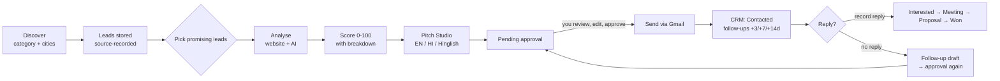
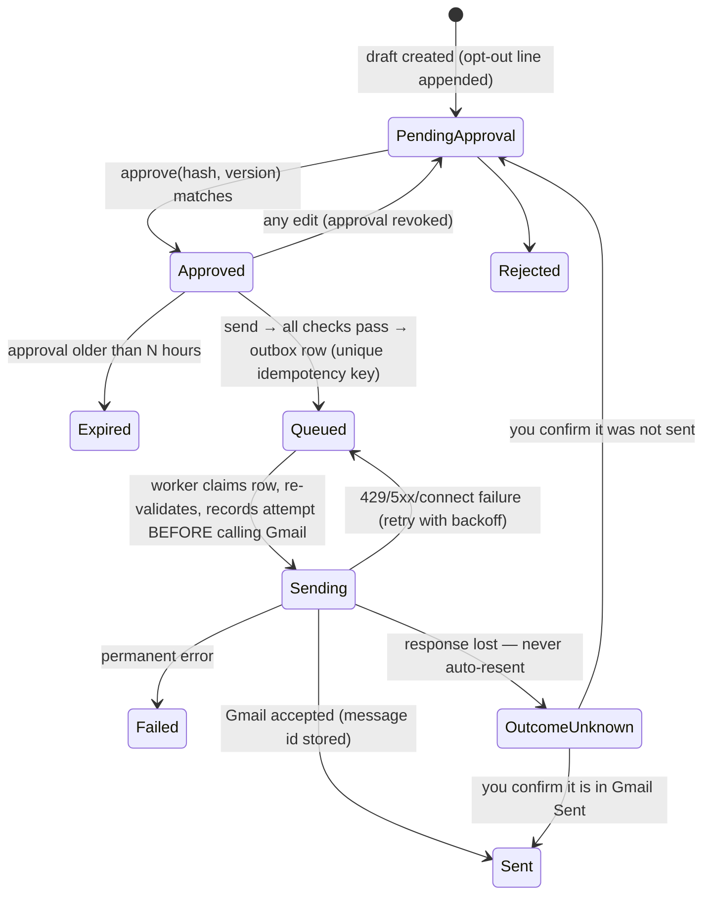
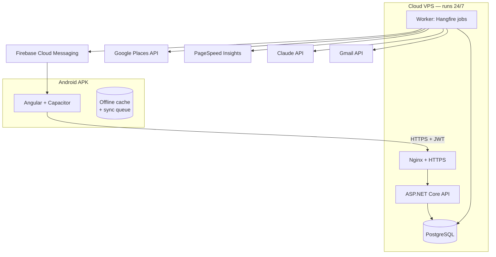
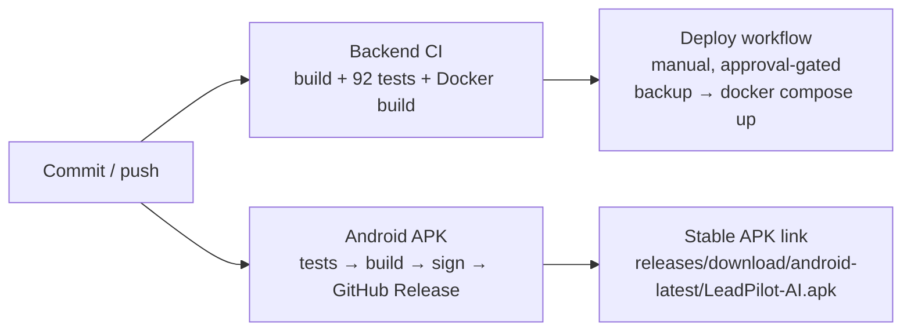

# LeadPilot AI — Workflows

## 1. Daily business workflow (what you do on your phone)

1. **Discover** (Discover tab): choose categories (e.g. Coaching institutes), state, cities (`Mumbai, Pune, Nashik, Surat`), filters (has/no website, phone, rating) and count. Tap *Estimate cost*, then *Start*. The job runs on the server; you get a push when it finishes. Or **import a CSV**.
2. **Review leads** (Leads tab): filter by *High priority*, *Has email*, *No website*, *Weak website*, stage or city.
3. **Analyse** (Lead → Analyse): the server inspects the public website (HTTPS, mobile, forms, booking, WhatsApp, SEO, broken links, PageSpeed), creates evidence-based opportunities, asks Claude for a structured assessment, then computes a deterministic score.
4. **Pitch** (Lead → Pitch): pick type and language; the draft references only observed opportunities. Edit and save.
5. **Approve** (Approvals tab): review recipient (with where it was found), subject, full body. *Approve* binds the approval to that exact content; any later edit invalidates it.
6. **Send**: the server re-checks everything (approval, content hash, opt-out list, limits, pause switch, Gmail connection) and sends through Gmail. CRM moves the lead to *Contacted* and schedules follow-ups.
7. **Follow up** (Follow-ups): due reminders arrive as notifications; follow-up drafts land in Approvals. Nothing is sent automatically.
8. **Close**: record replies, meetings, proposals and the deal value; track results in Reports.

## 2. Email safety workflow (server-enforced)

## 3. System workflow (cloud)

Background jobs (Hangfire, durable in PostgreSQL, resume after restarts): discovery jobs, website analysis, AI analysis, scoring, email outbox (every minute), follow-up reminders (every 15 min), maintenance & provider-data retention (daily), budget monitor (hourly).

## 4. Development & release workflow

